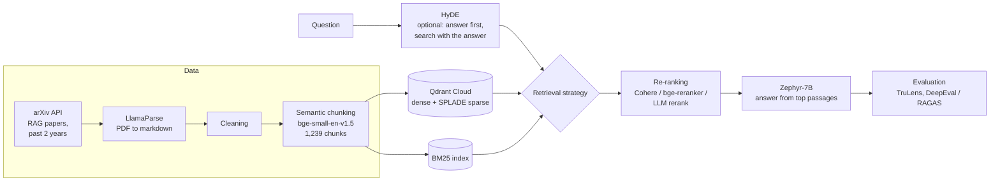
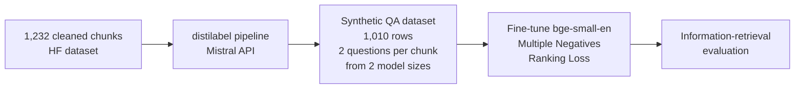

# RAG over RAG: A Retrieval Pipeline for Research Papers on Retrieval-Augmented Generation

A question-answering pipeline over recent arXiv papers about retrieval-augmented generation. It collects the papers, parses them into clean text, splits them by meaning rather than by length, and then compares several retrieval strategies (dense, sparse, hybrid, BM25, re-ranking and HyDE) before evaluating answers for faithfulness and relevance.

<p>
  
  
  
  
  
  
</p>

## How it works



### 1. Collecting the papers

`Rag_papers_Pipeline.ipynb` queries the **arXiv API** for retrieval-augmented generation papers from the past two years (about 500 results, 467 with PDF links) and stores each paper's title, publication date and PDF link. A set of 30 papers is downloaded for the knowledge base.

### 2. Parsing and chunking

Research PDFs contain tables, equations and two-column layouts that plain text extraction breaks. **LlamaParse** converts the PDFs into markdown (468 documents), which is then cleaned.

Instead of cutting text every *N* tokens, the pipeline uses **semantic chunking** (LlamaIndex `SemanticSplitterNodeParser`): it embeds consecutive sentences with [`BAAI/bge-small-en-v1.5`](https://huggingface.co/BAAI/bge-small-en-v1.5) and starts a new chunk where the meaning shifts sharply (95th-percentile breakpoint). This keeps each idea in one piece and produced **1,239 chunks**.

### 3. Retrieval strategies compared

| Strategy | How it works | Settings |
|---|---|---|
| **Dense** | Embedding similarity in Qdrant | `similarity_top_k=10` |
| **Dense + Cohere re-rank** | Retrieve 10, let a cross-encoder pick the best | Cohere Rerank, `top_n=2` |
| **Dense + LLM re-rank** | Zephyr-7B scores each retrieved passage | LlamaIndex `LLMRerank` |
| **Qdrant hybrid (dense + SPLADE)** | Learned sparse vectors catch exact terms; scores are fused | `sparse_top_k=12`, then Cohere re-rank |
| **Dense + BM25** | Custom retriever merges 10 vector and 10 keyword results | [`BAAI/bge-reranker-base`](https://huggingface.co/BAAI/bge-reranker-base), keeps the best 2 of ~14 |
| **HyDE** | Writes a hypothetical answer first and searches with it, so the query looks like the documents | `HyDEQueryTransform` |

Answers are generated with **Zephyr-7B-alpha** ([`HuggingFaceH4/zephyr-7b-alpha`](https://huggingface.co/HuggingFaceH4/zephyr-7b-alpha)) through the Hugging Face Inference API, using only the re-ranked passages.

### 4. Evaluation

A 100-question evaluation set (question, answer, retrieved contexts, ground truth) is scored with:

- **TruLens**: groundedness, i.e. whether each claim in the answer is supported by the retrieved context (NLI-based).
- **DeepEval** with RAGAS metrics: answer relevancy, faithfulness, contextual recall and contextual precision.

## Synthetic data and embedding fine-tuning

`distilabel_qa_synthetic_dataset_for_finetuning.ipynb` builds a question–answer dataset from the chunks so the embedding model can be adapted to this domain. Generation runs through a **distilabel** pipeline with Mistral models (including [`mistralai/Mistral-7B-Instruct-v0.2`](https://huggingface.co/mistralai/Mistral-7B-Instruct-v0.2)).



**Result.** On this dataset, fine-tuning did **not** improve retrieval (Accuracy@10 13.6% before, 13.1% after; Accuracy@1 2.1% vs 1.9%). Both scores are low, which points to the evaluation set rather than the model: many synthetic questions are generic enough to match several chunks from papers on the same topic, so only one counts as "correct". Filtering the generated questions for specificity, or scoring retrieval at the paper level, are the natural next steps. A related project with a cleaner dataset, [Embedding-Models-Finetuning](https://github.com/AreebAhmad-02/Embedding-Models-Finetuning), shows clear gains from the same method.

## Models and datasets on Hugging Face

| | Link | What it is |
|---|---|---|
| Dataset | [`Areeb-02/30ragpapersdataset`](https://huggingface.co/datasets/Areeb-02/30ragpapersdataset) | 1,232 cleaned chunks from the 30 papers |
| Dataset | [`Areeb-02/distilabel-aset-qa-30ragpapersdataset`](https://huggingface.co/datasets/Areeb-02/distilabel-aset-qa-30ragpapersdataset) | Raw distilabel generations for each chunk |
| Dataset | [`Areeb-02/30rag_papers_qa_dataset`](https://huggingface.co/datasets/Areeb-02/30rag_papers_qa_dataset) | Final synthetic QA dataset (1,010 rows) |
| Model | [`Areeb-02/bge-small-en-MultiplrRankingLoss-30-Rag-paper-dataset`](https://huggingface.co/Areeb-02/bge-small-en-MultiplrRankingLoss-30-Rag-paper-dataset) | Fine-tuned embedding model |
| Base model | [`BAAI/bge-small-en`](https://huggingface.co/BAAI/bge-small-en) | Embedding model before fine-tuning |

## Repository structure

```
notebooks/
├── Rag_papers_Pipeline.ipynb                         # arXiv collection, parsing, chunking, retrieval, re-ranking, HyDE, evaluation
├── Copy_of_Rag_papers_Pipeline.ipynb                 # Earlier version of the pipeline
└── distilabel_qa_synthetic_dataset_for_finetuning.ipynb  # Synthetic QA generation with distilabel
```

## Running the notebooks

The notebooks are designed for **Google Colab**. You will need API keys for LlamaParse (LlamaCloud), Qdrant Cloud, Cohere, Mistral and Hugging Face; set them as environment variables or Colab secrets rather than in the notebook.

## Author

**Areeb Ahmad Chaudhry**: [website](https://areebahmad-02.github.io) · [Google Scholar](https://scholar.google.com/citations?user=gaDnnFwAAAAJ) · [GitHub](https://github.com/AreebAhmad-02)
